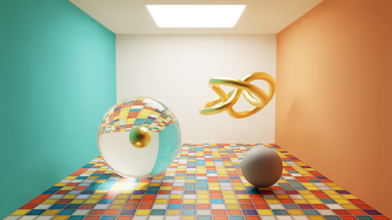
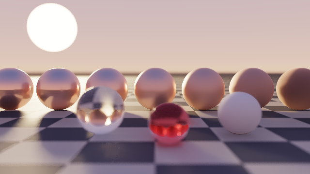
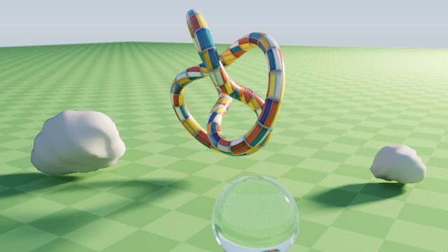
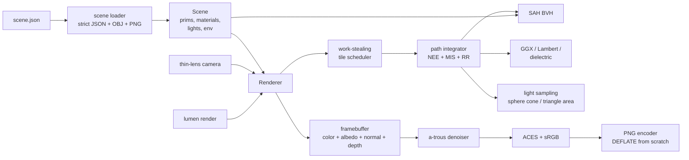

# lumen-tracer

[English](README.md) | [Português (Brasil)](README.pt-BR.md)

[](https://github.com/FrancisWorld/lumen-tracer/actions/workflows/ci.yml)
[](LICENSE)

A physically based path tracer in C++23, written from scratch with no rendering, image, JSON or test libraries: SAH BVH, GGX microfacets, glass, next-event estimation with multiple importance sampling, a work-stealing tile scheduler, bit-reproducible output, an a-trous denoiser, and its own PNG codec.



## Gallery

All three images are rendered by this repository from the scenes in [`scenes/`](scenes), at 640x360 and 256 samples per pixel, with the a-trous denoiser on. Timings are real runs on an Apple Silicon laptop (8 GB RAM) with the renderer limited to **2 threads**.

| Scene | What it exercises | Render time |
| --- | --- | --- |
| [`glass-atrium`](scenes/glass-atrium.json) (above) | area light + MIS, glass sphere with caustics, image-textured floor, gold GGX torus knot mesh, thin-lens DoF | 65.0 s |
| [`roughness-dusk`](scenes/roughness-dusk.json) | GGX roughness sweep (0.04 to 1.0), glass and tinted glass, emissive sphere "sun", gradient sky, wide-aperture DoF | 14.5 s |
| [`knot-study`](scenes/knot-study.json) | OBJ meshes with smooth normals and UVs, mosaic image texture on a knot, distant spherical sun (cone sampling), soft shadows | 25.5 s |

| | |
| --- | --- |
|  |  |

The texture and both meshes are generated by [`tools/gen_assets.cpp`](tools/gen_assets.cpp) (deterministic on the machine used here; CI only checks that the generator runs, because last-digit differences in `sin`/`cos` between platforms could change the text files), so every asset in the repository is original.

## Why it exists / what is hard about it

A path tracer is easy to get *almost* right and hard to get *provably* right. The images above look plausible, but a wrong pdf or a double-counted light only shows up as slightly off brightness. So the project is built around checks that would catch that:

- **Furnace and cavity tests.** A glass sphere in a uniform sky must return exactly the sky. A closed emissive diffuse cavity must converge to `E / (1 - albedo)`. These only pass if sampling, pdfs, MIS weights and Russian roulette are all consistent.
- **Analytic direct lighting.** The radiance leaving a floor point lit by a spherical light is compared with the closed-form irradiance `rho * L * (r/d)^2 * cos(theta)`.
- **Every sampler is paired with its pdf**, and the tests integrate each pdf over the sphere (cosine, cone, GGX visible normals) or compare `E[1/pdf]` with the true solid angle of a light (sphere from outside and inside, triangle).
- **Determinism.** Every pixel owns a PCG stream seeded from `(seed, x, y)`, so output is bit-identical for any thread count and any tile size. The test renders with 1, 2, 3 and 7 threads and three tile sizes and compares a digest of every buffer.
- **Hand-written file formats.** DEFLATE (LZ77 + fixed Huffman encoder, full stored/fixed/dynamic decoder), zlib, CRC-32, Adler-32 and PNG with all five filters. The decoder is checked against streams produced by Python's zlib and the encoder output is accepted by `file` and by Python's zlib.

## Architecture



| Module (`src/lumen/`) | Responsibility |
| --- | --- |
| `math`, `rng`, `sampling`, `microfacet` | vectors, transforms, PCG32 and per-pixel streams, sampling routines with pdfs, GGX D / G2 / visible-normal sampling |
| `geometry`, `bvh` | spheres, triangles, boxes; binned-SAH BVH with front-to-back traversal and any-hit |
| `bsdf`, `texture`, `scene` | scattering models, textures (constant, checker, bilinear image), primitives, light list and light sampling |
| `integrator` | path tracing loop |
| `scheduler`, `renderer`, `denoise`, `tonemap` | tile scheduling, framebuffer and guides, filtering, display transform |
| `deflate`, `png`, `json`, `obj`, `scene_loader` | file formats and the scene format |

## Quickstart

Needs CMake 3.25+, Ninja and a C++23 compiler. Nothing is downloaded: there are no dependencies.

```sh
cmake --preset release
cmake --build --preset release
ctest --preset release

./build/release/lumen render scenes/knot-study.json -o knot.png
```

Real output of that last command (2 worker threads on the machine above):

```text
scene scenes/knot-study.json: 8964 primitives, 1 lights, BVH 14127 nodes
rendering 640x360 at 256 spp, max depth 12
rendered 640x360 @ 256 spp in 25.49 s (2.31 Mpaths/s, 2 threads, 43 tile steals)
denoised in 0.18 s
wrote knot.png
```

```text
$ lumen info scenes/glass-atrium.json
primitives: 6415
lights: 2
bvh nodes: 8989 (leaves 4495, depth 19, max leaf 2)
image: 640x360, 256 spp, max depth 10, denoise on
```

Useful options (they override the scene file): `--spp`, `--width/--height`, `--depth`, `--threads`, `--seed`, `--tile`, `--exposure`, `--denoise/--no-denoise`, `--quiet`. Run `lumen --help` for the list. The same seed gives the same bytes: rendering `knot-study` at 160x90, 16 spp with `--threads 1` and `--threads 2` produced PNGs with identical SHA-256.

Other presets: `debug`, `asan` (AddressSanitizer + UBSan), `tsan` (ThreadSanitizer), `coverage` (`scripts/coverage.sh` prints an llvm-cov table), and `ci` (warnings as errors).

### Scene format

A scene is one JSON document (unknown keys are rejected, errors name the JSON path, for example `objects[3].material: unknown material "brass"`):

```json
{
  "settings":    { "width": 640, "height": 360, "samples": 256, "max_depth": 10, "denoise": true },
  "camera":      { "from": [0, 2, 8], "at": [0, 1.5, 0], "fov": 40, "aperture": 0.03, "focus_distance": 9.5 },
  "environment": { "type": "gradient", "horizon": [0.9, 0.6, 0.4], "zenith": [0.1, 0.2, 0.5] },
  "textures":    { "tiles": { "type": "image", "path": "tiles.png", "repeat": [3, 4] } },
  "materials": {
    "floor": { "base_color": "tiles", "roughness": 0.35 },
    "gold":  { "base_color": [1, 0.76, 0.33], "metallic": 1, "roughness": 0.22 },
    "glass": { "type": "dielectric", "ior": 1.5 },
    "lamp":  { "emission": [1, 0.9, 0.8], "emission_strength": 16 }
  },
  "objects": [
    { "type": "sphere", "center": [0, 1, 0], "radius": 1, "material": "glass" },
    { "type": "quad", "corner": [-3, 0, -3], "u": [6, 0, 0], "v": [0, 0, 6], "material": "floor" },
    { "type": "mesh", "path": "knot.obj", "material": "gold", "translate": [0, 2, 0], "scale": 0.4 }
  ]
}
```

Objects are `sphere`, `triangle`, `quad` and `mesh` (OBJ). Textures are `constant`, `checker` and `image` (PNG). Any object with an emissive material is a light.

## Design decisions and trade-offs

- **Single precision.** Float halves memory bandwidth in the BVH and keeps the code simple. The price is self-intersection: secondary rays start at `p + n * 1e-4 * (1 + |p|)` rather than using exact error bounds. That is a heuristic, not a guarantee.
- **Binned SAH, 16 bins, leaves of at most 4 primitives**, flattened into a depth-first array where the first child directly follows its parent. The BVH knows nothing about geometry; it calls back into a leaf test, which is why it can be tested against brute force with spheres and triangles mixed.
- **Light sampling.** Emissive primitives are chosen proportionally to emitted power. A sphere seen from outside is sampled by uniform cone, which has no noise from the sphere's far side; from inside it falls back to area sampling. `light_pdf` mirrors `sample_light` so MIS weights match exactly. The sky is not importance sampled: it is found by BSDF sampling only, so a small bright sun in the environment would be noisy. That is why scenes use an emissive sphere as the sun.
- **BSDF.** One GGX specular lobe over a Lambert base, blended by `metallic`. Both lobes are sampled stochastically and the pdf is the exact mixture, so MIS stays unbiased. The diffuse term is attenuated by the coat's Fresnel so the sum cannot exceed one (tested). Glass is perfectly smooth; there is no rough dielectric.
- **Emission is two-sided.** That makes closed emissive cavities (used as test oracles) and thin quad lights trivial, at the cost of the usual one-sided area light.
- **Work stealing.** Tiles are dealt out in contiguous chunks, one deque per worker; a worker pops from the front of its own deque and steals from the back of others. A test with deliberately slow tiles proves stealing happens. Workers are created per render call rather than kept in a long-lived pool, because rendering is the only client.
- **Denoiser.** A-trous wavelet filter with colour, normal and depth edge-stopping, run on irradiance (colour divided by first-hit albedo) so textures survive. The guides come from the first non-specular hit, which means refracted content seen through glass is filtered with the glass-back surface's guides; that is visible as slight softening behind glass.
- **PNG with fixed-Huffman DEFLATE.** Simpler than dynamic Huffman and fully correct, but files are larger than what zlib would produce. All gallery PNGs are 200 to 270 KB.
- **Own tiny test harness** instead of a framework fetched at configure time: the build needs no network, and the harness is about 150 lines.

## Testing

`ctest --preset release` runs 28 entries (23 suites plus 5 command-line checks); the suites hold 105 test cases.

| Area | What is proven |
| --- | --- |
| BVH | closest hit and any-hit equal brute force on 4000 random rays over mixed spheres and triangles; valid partition; SAH cost beats a flat list on clustered scenes; degenerate inputs |
| Sampling | each pdf integrates to 1; sample statistics match the pdf; GGX D is normalised in projected area; visible-normal pdf integrates to 1; sampled normals follow it |
| BSDF | sample weights equal quadrature albedo (sampler, eval and pdf agree); no energy creation; Snell, TIR, Fresnel split |
| Integrator | furnace (Lambert, glass, glass shell, GGX); emissive sphere and 12-triangle cavities hit the radiosity solution with and without Russian roulette; analytic direct lighting; shadows |
| Lights | `E[1/pdf]` equals the light's solid angle; `light_pdf` equals the sampled pdf; power-proportional selection |
| Render | bit-identical across threads/tiles; work stealing; exception propagation; progress |
| Denoiser | noise reduction, edge preservation, albedo preservation, thread independence, sky separation |
| Formats | CRC/Adler reference values, zlib dynamic-Huffman vector, PNG made by another encoder using all filters, corrupt-input rejection; JSON error positions, RFC 8259 edge cases; OBJ polygons and negative indices |
| CLI | version, info, render, error exit codes |

Measured line coverage of `src/lumen` is 93.8% (region coverage 94.5%) with `scripts/coverage.sh` (llvm-cov from Xcode). Verified clean on Apple clang 21 / macOS: the full suite under `release` and `asan` (ASan + UBSan), and the scheduler, render, denoiser and pipeline suites under `tsan`. ASan caught a real bug in a test (a reference to a temporary); it is fixed.

## Limitations

- CPU only, no SIMD in the BVH traversal. Throughput on the machine above was 0.9 to 4 million paths per second at 2 threads depending on the scene; no comparison with other renderers was made.
- Single-scattering GGX loses energy as roughness rises: a white metal at roughness 1 returns 0.31 in a furnace at normal incidence (measured in the test run). No multiple-scattering compensation.
- No rough glass, volumes, subsurface, spectral rendering, motion blur, instancing, HDR environment maps, or sky importance sampling.
- The denoiser has no variance estimate; its colour tolerance is a fixed parameter.
- The Linux/gcc 14 CI job was written but not run locally (only Apple clang on macOS was available); the macOS jobs mirror what was run.

## License

[MIT](LICENSE)

---

Built by [Chico Oliveira](https://github.com/FrancisWorld)
