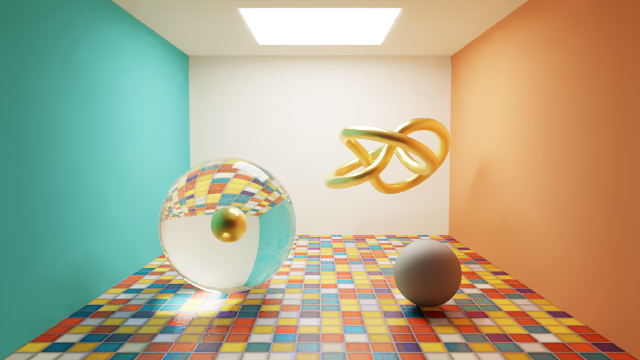
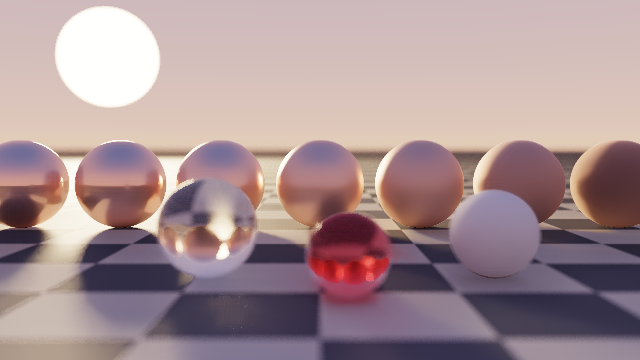
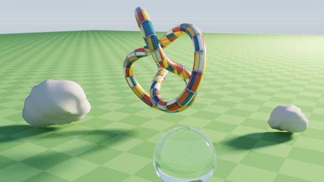
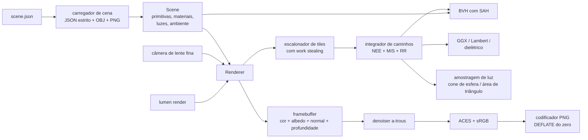

# lumen-tracer

[English](README.md) | [Português (Brasil)](README.pt-BR.md)

[](https://github.com/FrancisWorld/lumen-tracer/actions/workflows/ci.yml)
[](LICENSE)

Um path tracer fisicamente baseado em C++23, escrito do zero, sem bibliotecas de renderização, imagem, JSON ou teste: BVH com SAH, microfacetas GGX, vidro, next-event estimation com amostragem por importância múltipla (MIS), escalonador de tiles com work stealing, saída reproduzível bit a bit, denoiser a-trous e codec PNG próprio.



## Galeria

As três imagens são renderizadas por este repositório a partir das cenas em [`scenes/`](scenes), em 640x360 com 256 amostras por pixel e o denoiser a-trous ligado. Os tempos vêm de execuções reais em um notebook Apple Silicon (8 GB de RAM) com o renderizador limitado a **2 threads**.

| Cena | O que exercita | Tempo |
| --- | --- | --- |
| [`glass-atrium`](scenes/glass-atrium.json) (acima) | luz de área + MIS, esfera de vidro com cáusticas, piso com textura de imagem, nó toroidal dourado GGX (malha OBJ), profundidade de campo com lente fina | 65,0 s |
| [`roughness-dusk`](scenes/roughness-dusk.json) | varredura de rugosidade GGX (0,04 a 1,0), vidro e vidro tingido, esfera emissiva como "sol", céu em gradiente, DoF com abertura grande | 14,5 s |
| [`knot-study`](scenes/knot-study.json) | malhas OBJ com normais suaves e UVs, textura de mosaico no nó, sol esférico distante (amostragem por cone), sombras suaves | 25,5 s |

| | |
| --- | --- |
|  |  |

A textura e as duas malhas são geradas por [`tools/gen_assets.cpp`](tools/gen_assets.cpp) (determinístico; o CI as regenera e compara com os arquivos versionados), então todo asset do repositório é original.

## Por que existe / o que é difícil

É fácil fazer um path tracer ficar *quase* certo e difícil fazê-lo ficar *comprovadamente* certo. As imagens acima parecem plausíveis, mas um pdf errado ou uma luz contada duas vezes só aparece como um brilho levemente diferente. Por isso o projeto é construído em torno de verificações que pegariam isso:

- **Testes de fornalha e de cavidade.** Uma esfera de vidro num céu uniforme deve devolver exatamente o céu. Uma cavidade difusa emissiva fechada deve convergir para `E / (1 - albedo)`. Isso só passa se amostragem, pdfs, pesos de MIS e roleta russa forem todos consistentes.
- **Iluminação direta analítica.** A radiância que sai de um ponto do piso iluminado por uma luz esférica é comparada com a irradiância em forma fechada `rho * L * (r/d)^2 * cos(theta)`.
- **Todo amostrador tem seu pdf**, e os testes integram cada pdf sobre a esfera (cosseno, cone, normais visíveis GGX) ou comparam `E[1/pdf]` com o ângulo sólido real de uma luz (esfera por fora e por dentro, triângulo).
- **Determinismo.** Cada pixel tem seu fluxo PCG semeado por `(seed, x, y)`, então a saída é idêntica bit a bit para qualquer número de threads e qualquer tamanho de tile. O teste renderiza com 1, 2, 3 e 7 threads e três tamanhos de tile e compara um digest de todos os buffers.
- **Formatos escritos à mão.** DEFLATE (codificador LZ77 + Huffman fixo, decodificador completo para blocos stored/fixed/dynamic), zlib, CRC-32, Adler-32 e PNG com os cinco filtros. O decodificador é validado contra fluxos produzidos pelo zlib do Python, e a saída do codificador é aceita por `file` e pelo zlib do Python.

## Arquitetura



| Módulo (`src/lumen/`) | Responsabilidade |
| --- | --- |
| `math`, `rng`, `sampling`, `microfacet` | vetores, transformações, PCG32 e fluxos por pixel, rotinas de amostragem com pdfs, GGX D / G2 / amostragem de normais visíveis |
| `geometry`, `bvh` | esferas, triângulos, caixas; BVH com SAH em bins, travessia da frente para trás e any-hit |
| `bsdf`, `texture`, `scene` | modelos de espalhamento, texturas (constante, xadrez, imagem bilinear), primitivas, lista de luzes e amostragem de luz |
| `integrator` | laço do path tracing |
| `scheduler`, `renderer`, `denoise`, `tonemap` | escalonamento de tiles, framebuffer e guias, filtragem, transformação de exibição |
| `deflate`, `png`, `json`, `obj`, `scene_loader` | formatos de arquivo e o formato de cena |

## Início rápido

Precisa de CMake 3.25+, Ninja e um compilador C++23. Nada é baixado: não há dependências.

```sh
cmake --preset release
cmake --build --preset release
ctest --preset release

./build/release/lumen render scenes/knot-study.json -o knot.png
```

Saída real desse último comando (2 threads de trabalho na máquina acima):

```text
scene scenes/knot-study.json: 8964 primitives, 1 lights, BVH 14127 nodes
rendering 640x360 at 256 spp, max depth 12
rendered 640x360 @ 256 spp in 25.49 s (2.31 Mpaths/s, 2 threads, 43 tile steals)
denoised in 0.18 s
wrote knot.png
```

```text
$ lumen info scenes/glass-atrium.json
primitives: 6415
lights: 2
bvh nodes: 8989 (leaves 4495, depth 19, max leaf 2)
image: 640x360, 256 spp, max depth 10, denoise on
```

Opções úteis (sobrescrevem o arquivo de cena): `--spp`, `--width/--height`, `--depth`, `--threads`, `--seed`, `--tile`, `--exposure`, `--denoise/--no-denoise`, `--quiet`. Rode `lumen --help` para a lista. A mesma seed gera os mesmos bytes: renderizar `knot-study` em 160x90, 16 spp com `--threads 1` e `--threads 2` produziu PNGs com SHA-256 idêntico.

Outros presets: `debug`, `asan` (AddressSanitizer + UBSan), `tsan` (ThreadSanitizer), `coverage` (`scripts/coverage.sh` imprime uma tabela do llvm-cov) e `ci` (avisos como erros).

### Formato de cena

Uma cena é um documento JSON (chaves desconhecidas são rejeitadas e os erros indicam o caminho no JSON, por exemplo `objects[3].material: unknown material "brass"`; as mensagens de erro ficam em inglês):

```json
{
  "settings":    { "width": 640, "height": 360, "samples": 256, "max_depth": 10, "denoise": true },
  "camera":      { "from": [0, 2, 8], "at": [0, 1.5, 0], "fov": 40, "aperture": 0.03, "focus_distance": 9.5 },
  "environment": { "type": "gradient", "horizon": [0.9, 0.6, 0.4], "zenith": [0.1, 0.2, 0.5] },
  "textures":    { "tiles": { "type": "image", "path": "tiles.png", "repeat": [3, 4] } },
  "materials": {
    "floor": { "base_color": "tiles", "roughness": 0.35 },
    "gold":  { "base_color": [1, 0.76, 0.33], "metallic": 1, "roughness": 0.22 },
    "glass": { "type": "dielectric", "ior": 1.5 },
    "lamp":  { "emission": [1, 0.9, 0.8], "emission_strength": 16 }
  },
  "objects": [
    { "type": "sphere", "center": [0, 1, 0], "radius": 1, "material": "glass" },
    { "type": "quad", "corner": [-3, 0, -3], "u": [6, 0, 0], "v": [0, 0, 6], "material": "floor" },
    { "type": "mesh", "path": "knot.obj", "material": "gold", "translate": [0, 2, 0], "scale": 0.4 }
  ]
}
```

Os objetos são `sphere`, `triangle`, `quad` e `mesh` (OBJ). As texturas são `constant`, `checker` e `image` (PNG). Qualquer objeto com material emissivo é uma luz.

## Decisões de projeto e trade-offs

- **Precisão simples.** Float reduz pela metade a banda de memória na BVH e mantém o código simples. O preço é a auto-interseção: raios secundários começam em `p + n * 1e-4 * (1 + |p|)` em vez de usar limites de erro exatos. É uma heurística, não uma garantia.
- **SAH em bins, 16 bins, folhas com no máximo 4 primitivas**, achatada em um array em profundidade onde o primeiro filho vem logo após o pai. A BVH não conhece a geometria; ela chama um teste de folha, e por isso pode ser testada contra força bruta com esferas e triângulos misturados.
- **Amostragem de luz.** Primitivas emissivas são escolhidas proporcionalmente à potência emitida. Uma esfera vista de fora é amostrada por cone uniforme, sem ruído do lado oculto; vista de dentro, usa amostragem por área. `light_pdf` espelha `sample_light`, então os pesos de MIS coincidem exatamente. O céu não é amostrado por importância: só é encontrado pela amostragem da BSDF, então um sol pequeno e brilhante no ambiente seria ruidoso. Por isso as cenas usam uma esfera emissiva como sol.
- **BSDF.** Um lóbulo especular GGX sobre uma base Lambert, misturados por `metallic`. Os dois lóbulos são amostrados estocasticamente e o pdf é a mistura exata, então o MIS continua sem viés. O termo difuso é atenuado pelo Fresnel da camada, para que a soma não passe de um (testado). O vidro é perfeitamente liso; não há dielétrico rugoso.
- **A emissão é de dois lados.** Isso torna triviais as cavidades emissivas fechadas (usadas como oráculos de teste) e as luzes de quad finas, ao custo da luz de área de um lado só habitual.
- **Work stealing.** Os tiles são distribuídos em blocos contíguos, uma deque por worker; o worker retira da frente da própria deque e rouba do fim das outras. Um teste com tiles deliberadamente lentos prova que o roubo acontece. Os workers são criados a cada chamada de render, e não mantidos em um pool de longa duração, porque renderizar é o único cliente.
- **Denoiser.** Filtro wavelet a-trous com parada de borda por cor, normal e profundidade, aplicado à irradiância (cor dividida pelo albedo do primeiro hit) para que as texturas sobrevivam. As guias vêm do primeiro hit não especular, então o que é visto refratado através do vidro é filtrado com as guias da superfície de trás; isso aparece como leve suavização atrás do vidro.
- **PNG com DEFLATE Huffman fixo.** Mais simples que o Huffman dinâmico e totalmente correto, mas os arquivos ficam maiores do que o zlib produziria. Todos os PNGs da galeria têm de 200 a 270 KB.
- **Mini framework de testes próprio** em vez de um framework baixado na configuração: o build não precisa de rede, e o harness tem cerca de 150 linhas.

## Estratégia de testes

`ctest --preset release` executa 28 entradas (23 suítes mais 5 verificações de linha de comando); as suítes têm 105 casos de teste.

| Área | O que é provado |
| --- | --- |
| BVH | hit mais próximo e any-hit iguais à força bruta em 4000 raios aleatórios sobre esferas e triângulos misturados; partição válida; custo SAH menor que uma lista plana em cenas agrupadas; entradas degeneradas |
| Amostragem | cada pdf integra 1; estatísticas das amostras batem com o pdf; D do GGX normalizado em área projetada; pdf de normais visíveis integra 1; normais amostradas seguem esse pdf |
| BSDF | pesos das amostras iguais ao albedo por quadratura (amostrador, eval e pdf concordam); sem criação de energia; Snell, reflexão interna total, divisão de Fresnel |
| Integrador | fornalha (Lambert, vidro, casca de vidro, GGX); cavidades de esfera emissiva e de 12 triângulos atingem a solução de radiosidade com e sem roleta russa; iluminação direta analítica; sombras |
| Luzes | `E[1/pdf]` igual ao ângulo sólido da luz; `light_pdf` igual ao pdf amostrado; seleção proporcional à potência |
| Render | idêntico bit a bit entre threads/tiles; work stealing; propagação de exceção; progresso |
| Denoiser | redução de ruído, preservação de bordas, preservação de albedo, independência de threads, separação do céu |
| Formatos | valores de referência de CRC/Adler, vetor zlib Huffman dinâmico, PNG feito por outro codificador usando todos os filtros, rejeição de entrada corrompida; posições de erro do JSON, casos extremos da RFC 8259; polígonos e índices negativos do OBJ |
| CLI | versão, info, render, códigos de saída de erro |

A cobertura de linhas medida de `src/lumen` é 93,8% (cobertura de regiões 94,5%) com `scripts/coverage.sh` (llvm-cov do Xcode). Verificado sem falhas nos presets `release`, `asan` (ASan + UBSan) e `tsan` com Apple clang 21 / macOS. O ASan pegou um bug real em um teste (referência a um temporário); já está corrigido.

## Limitações

- Somente CPU, sem SIMD na travessia da BVH. A vazão na máquina acima foi de 0,9 a 4 milhões de caminhos por segundo com 2 threads, dependendo da cena; não foi feita comparação com outros renderizadores.
- O GGX de espalhamento único perde energia conforme a rugosidade sobe: um metal branco com rugosidade 1 devolve 0,31 numa fornalha com incidência normal (medido na execução dos testes). Não há compensação de espalhamento múltiplo.
- Sem vidro rugoso, volumes, subsurface, renderização espectral, motion blur, instanciamento, mapas de ambiente HDR ou amostragem por importância do céu.
- O denoiser não tem estimativa de variância; a tolerância de cor é um parâmetro fixo.
- O job de CI Linux/gcc 14 foi escrito mas não executado localmente (só havia Apple clang no macOS); os jobs de macOS espelham o que foi executado.

## Licença

[MIT](LICENSE)

---

Built by [Chico Oliveira](https://github.com/FrancisWorld)
